<p align="center">
  
</p>

<h1 align="center">BidZone</h1>

<p align="center"><b>High-Concurrency Real-Time Auction Platform</b><br/>Every bid lands. Exactly once.</p>

<p align="center">

[](https://github.com/tanmay-madan/bidzone-auction-platform/actions/workflows/ci.yml)


</p>

> A full-stack, real-time auction platform engineered to guarantee state consistency under high-frequency concurrent bidding, using database-level concurrency control, transaction-scoped event delivery, advisory-lock settlement and empirical performance benchmarking.

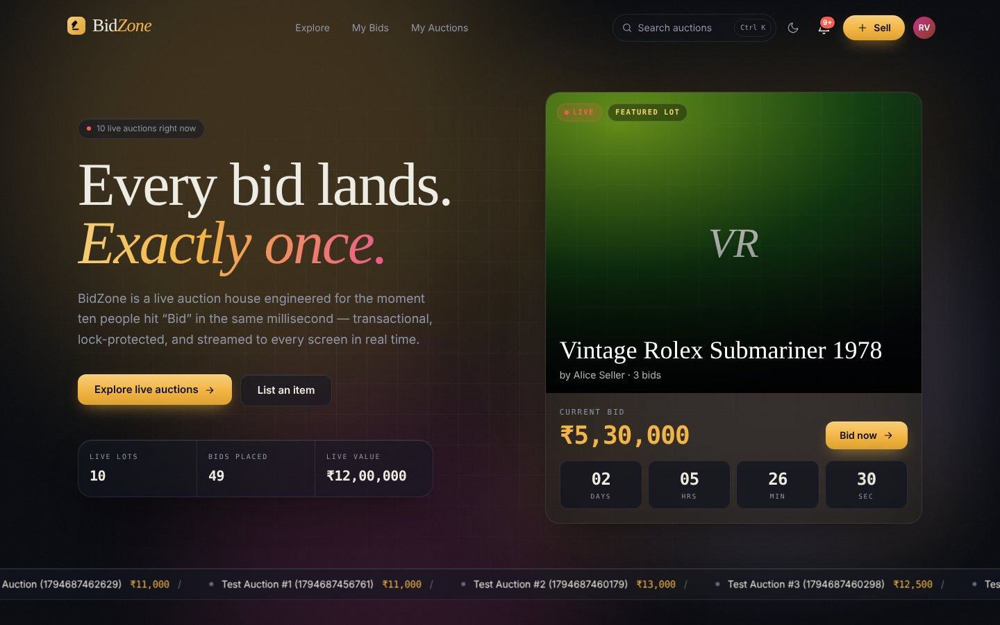

---

## Table of Contents

1. [Problem Statement & Technical Highlights](#1-problem-statement--technical-highlights)
2. [Feature Overview](#2-feature-overview)
3. [Screenshots](#3-screenshots)
4. [Technology Stack](#4-technology-stack)
5. [Architecture & Data Model](#5-architecture--data-model)
6. [Concurrency Control Design](#6-concurrency-control-design)
7. [One-Command Setup (Docker Compose)](#7-one-command-setup-docker-compose)
8. [Local Development Setup (Manual)](#8-local-development-setup-manual)
9. [Verification & Test Suite Execution](#9-verification--test-suite-execution)
10. [Empirical Findings & Benchmarks](#10-empirical-findings--benchmarks)
11. [API Specification & Error Contract](#11-api-specification--error-contract)
12. [Project Structure](#12-project-structure)
13. [Security Considerations](#13-security-considerations)
14. [Deployment](#14-deployment)

---

## 1. Problem Statement & Technical Highlights

In auction platforms, naive application-level checks (`SELECT current_bid` followed by `UPDATE ...`) produce **lost-update race conditions** when concurrent users bid in the same millisecond. Multiple bids at identical prices get accepted, or a lower bid overwrites a higher one.

BidZone solves this at the database layer:

* **Pessimistic Concurrency (`SELECT ... FOR UPDATE`):** Exclusive row-level locking inside explicit PostgreSQL transactions serializes all bids on the same auction.
* **Dual-Engine Architecture & OCC Benchmark:** An **Optimistic Concurrency Control** engine (`version` column + jittered exponential backoff) benchmarked against pessimistic locking at N = 10, 50 and 200 concurrent bidders.
* **Database-Clock Validation:** Bid eligibility (`starts_at <= now() < ends_at`) is evaluated against PostgreSQL's clock, never the client's or application server's.
* **Anti-Sniping Engine:** Bids submitted within the final 2 minutes extend the auction by 2 minutes inside the same atomic transaction, preventing double-extension races.
* **Exactly-Once Settlement:** A scheduled settlement worker guarded by **PostgreSQL transaction-level advisory locks** (`pg_try_advisory_xact_lock`) and a `settled_at` marker, preventing duplicate winner processing across multi-replica deployments.
* **Idempotency Protection:** Client-generated `Idempotency-Key` headers cache and replay the original response on network retries.
* **Commit-Safe Real-Time Delivery:** Bid and settlement events are emitted with `pg_notify` inside the transaction and delivered to browsers over **Server-Sent Events** only after `COMMIT`, so rolled-back bids are never broadcast.
* **Race-Free Seller Actions:** Editing or deleting an auction locks the same row as bidding, so a seller's change can never overwrite or erase a bid that lands at the same moment.
* **Production Hardening:** Strict configuration checks, CORS allow-listing, rate limiting, input validation against database limits and benchmark-only modes that are disabled in production, so the row lock can never be bypassed.

---

## 2. Feature Overview

### Bidding & Auction Lifecycle
| Feature | Description |
| :--- | :--- |
| Concurrency-safe bidding | Row-locked transactions with minimum-increment validation |
| Bid audit trail | Every bid is recorded as `ACCEPTED` or `REJECTED` with a reason code |
| Anti-sniping | Automatic 2-minute extension for late bids |
| Automatic settlement | Expired auctions are closed every 15 seconds (configurable) |
| Winner determination | Highest accepted bid wins; winner, seller and other bidders are notified |
| Safe seller edits | Edits and deletions are allowed only before the first bid, checked under a row lock |

### Real-Time Experience
| Feature | Description |
| :--- | :--- |
| Live price updates | Prices, bid history and countdowns update without a page refresh |
| Notifications | In-app notification centre with unread count for *outbid*, *new bid*, *won*, *sold* and *ended* events |
| Live activity feed | Site-wide stream of the latest accepted bids, filled on page load and updated live |
| Urgency signals | *Ending soon* badge in the final hour and *Popular* badge for auctions with three or more bids |
| Live countdowns | Second-by-second timers that turn red in the final two minutes |
| Winner screen | Winner banner and celebration on auction close |

### Marketplace & Accounts
| Feature | Description |
| :--- | :--- |
| Auction management | Create auctions with live preview; edit or delete before the first bid |
| Discovery | Search, status filters (Live / Upcoming / Ended), sorting and `Ctrl / ⌘ + K` quick search |
| Dashboards | *My Bids* (Winning / Outbid / Won / Lost) and *My Auctions* (seller statistics) |
| Authentication | bcrypt password hashing and JWT-based sessions |
| User profile | Edit name, email, phone, location, bio and profile photo; change password; personal activity statistics |

### Interface
| Feature | Description |
| :--- | :--- |
| Brand identity | Original bidding-paddle logo with a hover animation, favicon, app icons and an installable web manifest |
| Design system | Glassmorphism UI built on Tailwind CSS and CSS variables |
| Motion | Animated background, price count-ups, card spotlight and tilt, scroll reveals and an animated bidding example on sign-in |
| Theming | Light and dark modes, following the system preference by default |
| Responsive layout | Desktop layout and a mobile layout with bottom tab navigation |
| Accessibility | Animations are disabled when the operating system requests reduced motion |
| Error states | Friendly 404 page, inline form validation and automatic sign-out when a session expires |

---

## 3. Screenshots

| Live Bidding (Outbid Notification) | Auction Settlement (Winner View) |
| :---: | :---: |
| 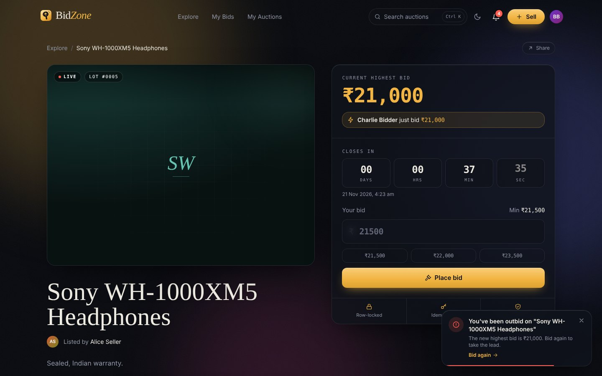 | 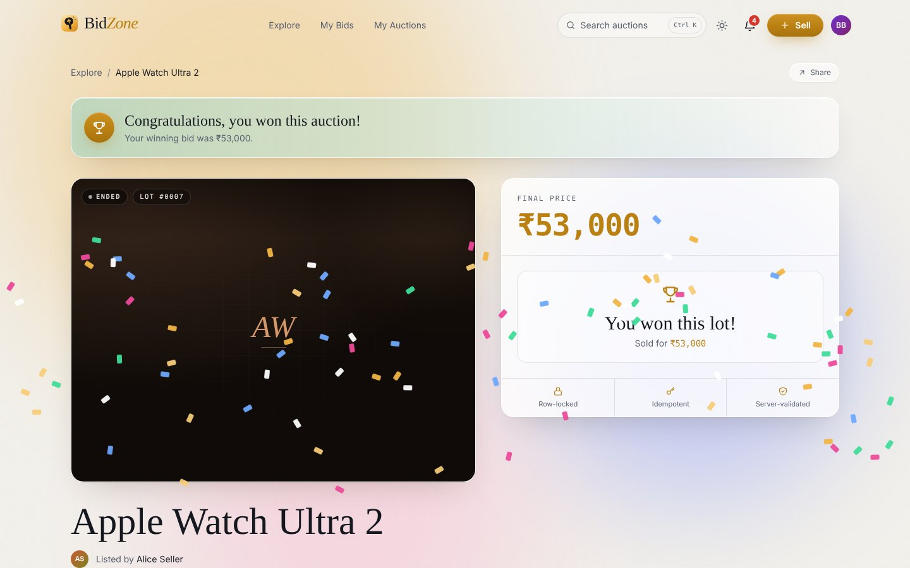 |
| **Auction Page (Light Theme)** | **Browse Auctions** |
| 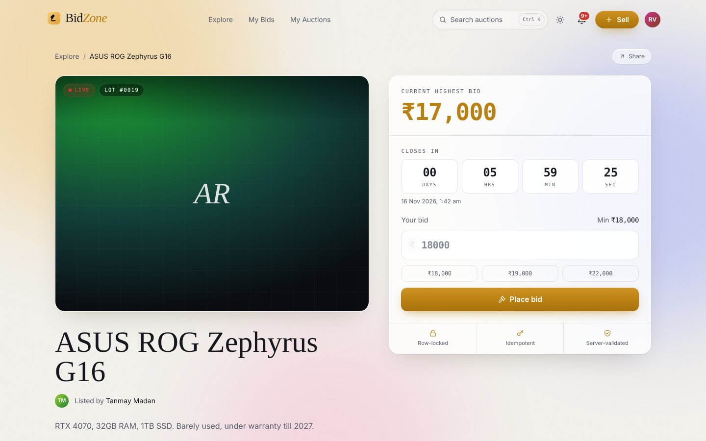 | 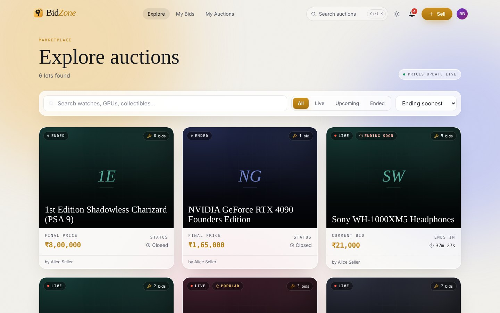 |
| **Notification Centre** | **Quick Search** |
| 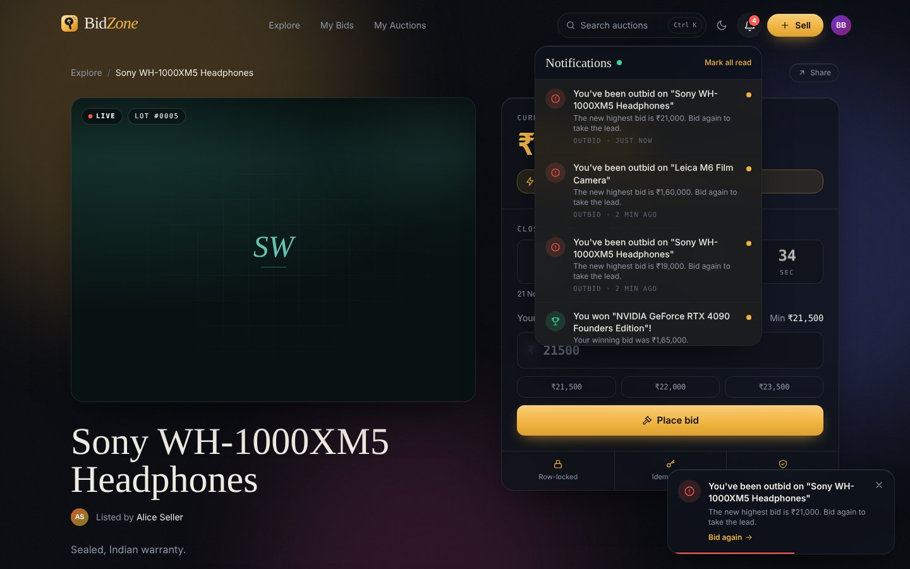 | 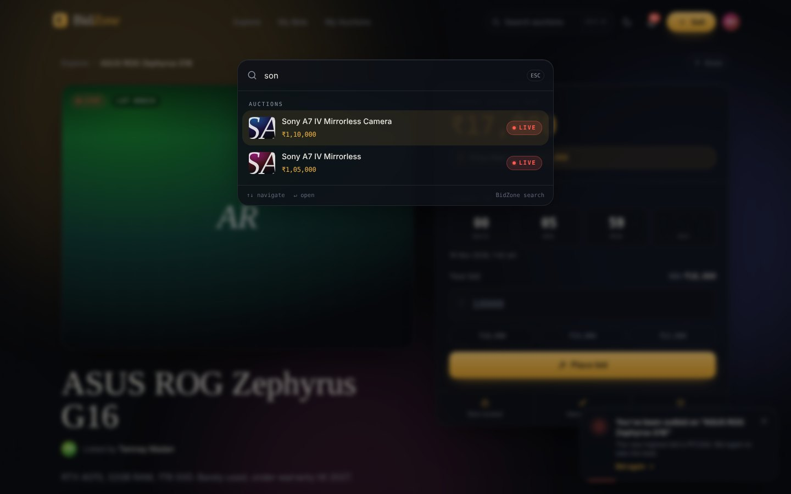 |
| **User Profile** | **Mobile Layout** |
| 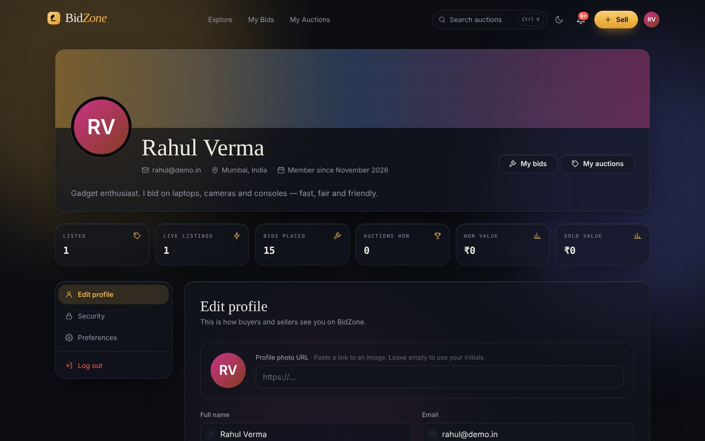 | 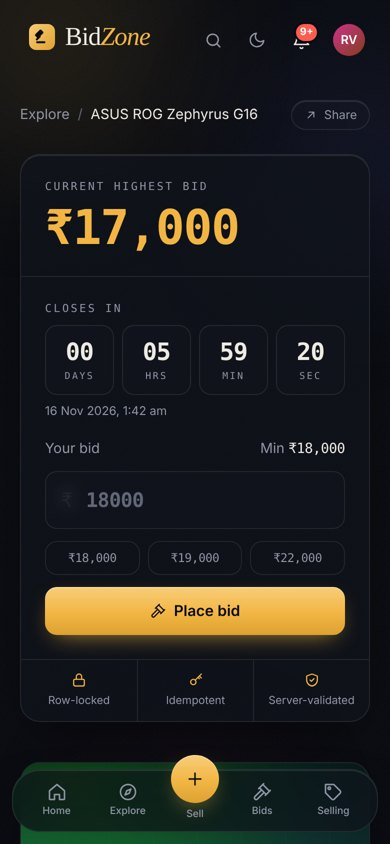 |

*Screenshots were captured in an offline environment; product images are rendered as generated placeholders.*

---

## 4. Technology Stack

| Layer | Technology | Responsibility |
| :--- | :--- | :--- |
| Presentation | React 19, Vite, React Router | User interface and client-side routing |
| Styling | Tailwind CSS 3, CSS custom properties | Design system and light/dark theming |
| Application | Node.js 20, Express 4 | REST API, authentication, business rules |
| Data | PostgreSQL 16, `pg` connection pool | Persistence, transactions, locking, `LISTEN/NOTIFY` |
| Real-Time | Server-Sent Events, `pg_notify` | Live bids, settlements and notifications |
| Security | bcrypt, JSON Web Tokens | Password hashing and session tokens |
| Infrastructure | Docker Compose, Nginx, GitHub Actions | Containerised setup, static serving, CI |
| Hosting | Render (API + PostgreSQL), Vercel (frontend) | Production deployment |

---

## 5. Architecture & Data Model

### System Architecture
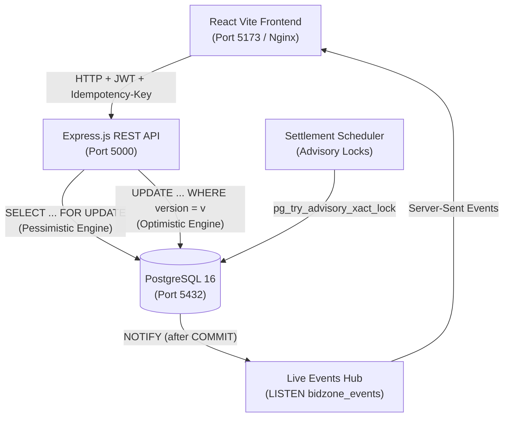

### Bid Processing Sequence
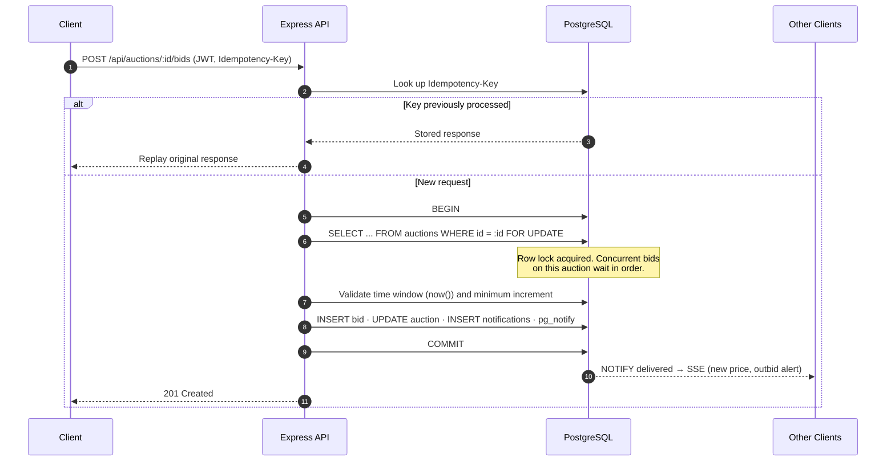

### Entity-Relationship (ER) Diagram
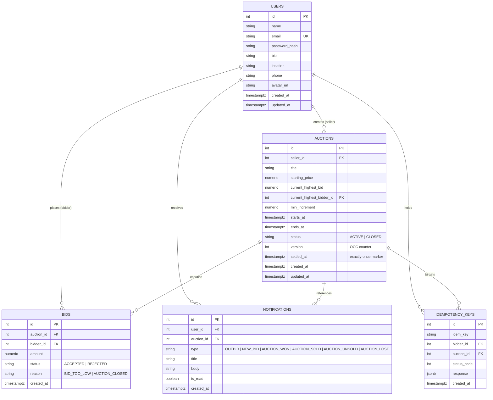

### Database Migrations
| Migration | Purpose |
| :--- | :--- |
| `001_add_idempotency_keys.sql` | Duplicate-request protection |
| `002_add_version_column.sql` | `version` column for optimistic concurrency control |
| `003_add_active_auctions_index.sql` | Partial index for active auctions ordered by end time |
| `004_add_notifications_and_settlement.sql` | `notifications` table and `settled_at` settlement marker |
| `005_add_user_profile_fields.sql` | User profile fields (bio, location, phone, avatar) |

All migrations are additive and idempotent (`IF NOT EXISTS`). `database/schema.sql` already includes every migration for fresh installations.

---

## 6. Concurrency Control Design

| Mechanism | Implementation | Guarantee |
| :--- | :--- | :--- |
| Pessimistic locking | `SELECT ... FOR UPDATE` inside `BEGIN ... COMMIT` | Bids on the same auction are serialized; no lost updates |
| Optimistic locking | `UPDATE ... WHERE id = $1 AND version = $2` with jittered backoff | Compare-and-swap correctness; used for benchmarking |
| Time authority | `starts_at <= now() < ends_at` evaluated in PostgreSQL | No dependence on client or server clock skew |
| Idempotency | `UNIQUE (idem_key, bidder_id, auction_id)` with stored response | A retried request never creates a second bid |
| Anti-sniping | `ends_at` extended within the locked transaction | Late bids cannot double-extend an auction |
| Settlement | `pg_try_advisory_xact_lock` + `settled_at` | Each auction is settled and announced exactly once |
| Event delivery | `pg_notify` inside the transaction | Only committed state is broadcast to clients |
| Seller edits | `SELECT ... FOR UPDATE` before the "no bids yet" check | An edit or deletion can never race a bid |
| Production safety | Benchmark modes (`?strategy=`, `?anti_sniping=`) disabled when `NODE_ENV=production` | Clients cannot bypass the row lock |

---

## 7. One-Command Setup (Docker Compose)

Run the entire platform (PostgreSQL + Express Backend + React Frontend + Seed Data) in one command:

```bash
docker compose up --build
```

* **Frontend:** `http://localhost:5173`
* **Backend API:** `http://localhost:5000/api`
* **Health Check:** `http://localhost:5000/api/health`

The backend container applies the schema automatically on every start (`npm run migrate` is idempotent), so existing Docker volumes are upgraded without manual steps. The Docker stack runs the API with `NODE_ENV=production`; set `ALLOW_TEST_MODES=true` to run the benchmark and evidence scripts against it.

### Demo Credentials (Pre-seeded)
| Role | Email | Password |
| :--- | :--- | :--- |
| **Seller** | `alice@bidzone.local` | `password123` |
| **Bidder 1** | `bob@bidzone.local` | `password123` |
| **Bidder 2** | `charlie@bidzone.local` | `password123` |
| **Evaluator** | `demo@bidzone.local` | `password123` |

To observe real-time behaviour, sign in as two different bidders in separate browser sessions, open the same auction and place a bid from one session.

---

## 8. Local Development Setup (Manual)

**Prerequisites:** Node.js 20+, PostgreSQL 16+

### 1. Database
```bash
createdb bidzone
```

### 2. Backend
```bash
cd backend
cp .env.example .env      # set DB_PASSWORD and JWT_SECRET
npm install
npm run migrate           # apply schema (safe to re-run)
npm run seed              # demo users and auctions (safe to re-run)
npm run dev
```

On successful start-up the server reports:
```text
BidZone API listening on http://localhost:5000
Live events: listening on PostgreSQL channel bidzone_events
Settlement scheduler running every 15s
```

### 3. Frontend
```bash
cd frontend
cp .env.example .env
npm install
npm run dev
```

### Environment Variables
| Variable | Scope | Default | Description |
| :--- | :--- | :--- | :--- |
| `PORT` | Backend | `5000` | API port |
| `NODE_ENV` | Backend | `development` | `production` enables strict checks (see Section 13) |
| `DATABASE_URL` | Backend | Not set | Full connection string (hosted databases); overrides `DB_*` |
| `DB_HOST`, `DB_PORT` | Backend | `localhost`, `5432` | PostgreSQL host and port |
| `DB_USER`, `DB_PASSWORD` | Backend | `postgres`, not set | PostgreSQL credentials |
| `DB_NAME` | Backend | `bidzone` | Database name |
| `DB_SSL` | Backend | SSL on | Set to `false` when `DATABASE_URL` points to a database without SSL |
| `JWT_SECRET` | Backend | Required | Secret used to sign JWTs; at least 32 characters in production |
| `CORS_ORIGIN` | Backend | any origin | Comma-separated frontend URLs allowed to call the API |
| `ALLOW_TEST_MODES` | Backend | on in dev, off in prod | Enables `?strategy=naive\|optimistic` and `?anti_sniping=` for benchmarks |
| `SETTLEMENT_SCHEDULER` | Backend | `on` | Set to `off` to disable automatic settlement |
| `SETTLEMENT_INTERVAL_MS` | Backend | `15000` | Settlement sweep interval |
| `VITE_API_URL` | Frontend | `http://localhost:5000/api` | Backend base URL |

For production hosting (Render, Neon, Vercel), see [`DEPLOYMENT.md`](DEPLOYMENT.md).

---

## 9. Verification & Test Suite Execution

All test suites run against the live PostgreSQL database and output reproducible verification logs. The suites also run on every push via GitHub Actions.

```bash
cd backend

# 1. Database relational & invariant consistency check
node scripts/consistency-check.js

# 2. 5-Scenario Concurrency Suite (50 simultaneous bids, closing time, idempotency)
node scripts/concurrency-test.js

# 3. Naive failure vs. Fixed pessimistic evidence generation
node scripts/generate-evidence.js

# 4. Dual-Engine Benchmark: Optimistic vs Pessimistic (N=10, 50, 200)
node scripts/benchmark-concurrency.js

# 5. Scale Seeding (50,000+ rows) & EXPLAIN ANALYZE query plan speedup
node scripts/scale-seed-and-analyze.js

# 6. Security, Shill Bidding & IDOR Authorization Suite
node scripts/security-idor-test.js

# 7. Exactly-Once Settlement (Advisory Locks) & Anti-Sniping Test
node scripts/settlement-and-sniping-test.js
```

> **Note:** `settlement-and-sniping-test.js` intentionally moves an auction's end time into the past. Running `consistency-check.js` afterwards on the same database will report that test auction as a time-window violation; this is expected test data.

Recorded outputs are available in [`docs/evidence/`](docs/evidence/). A Postman collection is provided at [`docs/BidZone.postman_collection.json`](docs/BidZone.postman_collection.json).

---

## 10. Empirical Findings & Benchmarks

### A. Naive Failure vs. Fixed Invariant
* **Naive Unshielded Run:** Firing 50 simultaneous bids of ₹11,000 accepted **48 duplicate bids** at the same price level due to uncoordinated reads.
* **Pessimistic `FOR UPDATE` Run:** The identical 50 concurrent bids accepted **exactly 1 bid** and rejected **49 bids** with `HTTP 409 BID_TOO_LOW`.

### B. Concurrency Benchmark: Pessimistic vs. Optimistic OCC

| Strategy | Concurrency (N) | Total Time | Throughput | p50 Latency | p95 Latency | Retries |
| :--- | :---: | :---: | :---: | :---: | :---: | :---: |
| **PESSIMISTIC** | 10 | 357 ms | 28.0 req/s | 282 ms | 355 ms | 0 |
| **OPTIMISTIC** | 10 | 162 ms | **61.7 req/s** | 108 ms | **159 ms** | 20 |
| **PESSIMISTIC** | 50 | 401 ms | **124.7 req/s** | 248 ms | **385 ms** | 0 |
| **OPTIMISTIC** | 50 | 499 ms | 100.2 req/s | 205 ms | 410 ms | 96 |
| **PESSIMISTIC** | 200 | 1328 ms | 150.6 req/s | 960 ms | 1266 ms | 0 |
| **OPTIMISTIC** | 200 | 638 ms | 313.5 req/s | 560 ms | 613 ms | 347 |

> **Architectural Takeaway:** Optimistic concurrency achieves lower latency at low contention by avoiding lock bookkeeping. At high contention (N ≥ 50), collisions force hundreds of backoff retries (347 retries at N = 200), whereas pessimistic row locking queues requests inside PostgreSQL with zero retries. Pessimistic locking is therefore the default engine for live bidding.

Full report: [`docs/evidence/03-concurrency-benchmark.md`](docs/evidence/03-concurrency-benchmark.md)

### C. Scale Seeding & `EXPLAIN ANALYZE` Query Optimization
* **Dataset Scale:** 1,000 users, 6,000 auctions, 50,000 bids.
* **Target Query:** Active auctions ending soonest (`WHERE status = 'ACTIVE' AND ends_at > now() ORDER BY ends_at ASC LIMIT 20`).
* **Before Partial Index:** Full `Seq Scan` + Top-N Heapsort = **5.217 ms**
* **After Partial Index:** Direct B-Tree `Index Scan` = **0.098 ms** (**53.2x speedup**).

Full plan: [`docs/evidence/04-explain-analyze.txt`](docs/evidence/04-explain-analyze.txt)

---

## 11. API Specification & Error Contract

Base URL: `http://localhost:5000/api`. Endpoints marked *Authenticated* require `Authorization: Bearer <token>`.

### Authentication & Profile
| Method | Endpoint | Description | Status Codes |
| :--- | :--- | :--- | :--- |
| `POST` | `/api/auth/register` | Register new user | `201`, `400`, `409`, `429` |
| `POST` | `/api/auth/login` | Login user & issue JWT | `200`, `400`, `401`, `429` |
| `GET` | `/api/auth/me` | Current user (Authenticated) | `200`, `401`, `404` |
| `GET` | `/api/profile` | Profile details & activity statistics (Authenticated) | `200`, `401`, `404` |
| `PATCH` | `/api/profile` | Update name, email, phone, location, bio, avatar (Authenticated) | `200`, `400`, `401`, `409` |
| `PUT` | `/api/profile/password` | Change password; requires current password (Authenticated) | `200`, `400`, `401` |

### Auctions & Bidding
| Method | Endpoint | Description | Status Codes |
| :--- | :--- | :--- | :--- |
| `GET` | `/api/auctions` | Browse auctions (`search`, `status`, `sort`) | `200` |
| `GET` | `/api/auctions/:id` | Get auction details & highest bid | `200`, `404` |
| `POST` | `/api/auctions` | Create new auction (Authenticated) | `201`, `400`, `401` |
| `PUT` | `/api/auctions/:id` | Update auction (Owner only) | `200`, `400`, `403`, `404`, `409` |
| `DELETE` | `/api/auctions/:id` | Delete auction (Owner only) | `200`, `403`, `404`, `409` |
| `POST` | `/api/auctions/:id/bids` | Place concurrency-safe bid (Authenticated, supports `Idempotency-Key`) | `201`, `400`, `403`, `404`, `409`, `429` |
| `GET` | `/api/auctions/:id/bids` | View bid history | `200` |
| `GET` | `/api/my-auctions` | Auctions listed by the current user (Authenticated) | `200`, `401` |
| `GET` | `/api/my-bids` | Auctions the current user has bid on (Authenticated) | `200`, `401` |
| `POST` | `/api/auctions/:id/settle` | Manually settle an expired auction (Seller only, Advisory Lock) | `200`, `401`, `403`, `404`, `500` |
| `POST` | `/api/auctions/settle-expired` | Run the settlement sweep manually (Authenticated) | `200`, `401`, `500` |

### Real-Time & Notifications
| Method | Endpoint | Description | Status Codes |
| :--- | :--- | :--- | :--- |
| `GET` | `/api/activity` | Latest accepted bids across all auctions (activity feed) | `200` |
| `GET` | `/api/stream?token=<jwt>` | Server-Sent Events stream (`bid`, `closed`, `notification`) | `200` |
| `GET` | `/api/notifications` | Latest notifications & unread count (Authenticated) | `200`, `401` |
| `POST` | `/api/notifications/:id/read` | Mark a notification as read (Authenticated) | `200`, `401`, `404` |
| `POST` | `/api/notifications/read-all` | Mark all notifications as read (Authenticated) | `200`, `401` |
| `GET` | `/api/health` | API and database health check | `200` |

### Error Contract
Bidding endpoints return a consistent, machine-readable JSON error format:
```json
{
  "success": false,
  "code": "BID_TOO_LOW",
  "message": "Your bid must be at least 12000."
}
```

Other endpoints return the error code in an `error` field, with an optional `field` for validation errors:
```json
{
  "error": "VALIDATION_ERROR",
  "message": "Enter a valid email address.",
  "field": "email"
}
```

Error codes handled by clients: `BID_TOO_LOW`, `AUCTION_CLOSED`, `AUCTION_NOT_STARTED`, `SELLER_CANNOT_BID`, `AUCTION_HAS_BIDS`, `INVALID_CREDENTIALS`, `EMAIL_TAKEN`, `WRONG_PASSWORD`, `FORBIDDEN`, `NOT_FOUND`, `VALIDATION_ERROR`, `SERVER_ERROR`.

---

## 12. Project Structure

```text
bidzone-auction-platform/
├── backend/
│   ├── scripts/            # Concurrency, consistency, security, benchmark & settlement suites
│   └── src/
│       ├── controllers/    # auth, profile, auctions, bids, notifications
│       ├── db/             # PostgreSQL connection pool
│       ├── middleware/     # JWT authentication, security headers, rate limiting
│       ├── routes/         # REST and Server-Sent Events routes
│       ├── services/       # Live events hub (LISTEN/NOTIFY → SSE), notification service
│       ├── utils/          # JWT helpers
│       ├── workers/        # Settlement worker and scheduler (advisory locks)
│       ├── config.js       # Environment loading and production checks
│       ├── app.js
│       └── server.js
├── database/
│   ├── schema.sql          # Complete schema (includes all migrations)
│   ├── seed.sql            # Demo users and auctions
│   └── migrations/         # 001 to 005
├── frontend/
│   ├── public/             # Logo, favicon, app icons, web manifest
│   └── src/
│       ├── components/     # UI primitives, navigation, auction cards, notifications, search
│       ├── context/        # Authentication, live events and theme providers
│       ├── hooks/          # Live countdown hook
│       ├── layouts/        # Application shell
│       ├── pages/          # Home, Browse, Auction, Create, Dashboards, Profile, Auth
│       ├── services/       # API client
│       └── utils/          # Formatting helpers
├── docs/
│   ├── evidence/           # Recorded test and benchmark outputs
│   └── screenshots/
├── .github/workflows/      # Continuous integration
├── docker-compose.yml      # One-command local stack
├── render.yaml             # Render blueprint (API + PostgreSQL)
└── DEPLOYMENT.md           # Step-by-step production deployment guide
```

---

## 13. Security Considerations

* **Password storage:** Passwords are hashed with bcrypt and never returned by the API.
* **SQL injection:** All queries use parameterized statements.
* **Authorization:** Auction edits and deletions are restricted to the owner, sellers cannot bid on their own auctions, and manual settlement is restricted to the seller. Notification queries are always scoped to the authenticated user.
* **Profile updates:** Only whitelisted fields are writable; email uniqueness is enforced; avatar URLs must use `http` or `https`; password changes require the current password.
* **Input validation:** Request bodies and route parameters are validated against the database limits, so malformed input returns `400`/`404` instead of a server error. Auction edits and deletions lock the auction row, so they cannot overwrite a concurrent bid.
* **Rate limiting:** Login attempts are limited to 10 per email per IP every 15 minutes, bid attempts to 120 per user per minute, and in production sign-ups to 20 per IP per hour.
* **Production mode (`NODE_ENV=production`):** The API refuses to start without a strong `JWT_SECRET`, restricts browser access to `CORS_ORIGIN`, and disables the benchmark-only bidding modes so the row lock cannot be bypassed.
* **Secrets management:** `.env` files are excluded from version control; only `.env.example` templates are committed.
* **Known trade-offs:** JWTs are stored in `localStorage` for simplicity (an `httpOnly` cookie would offer stronger XSS protection). The SSE stream receives the token as a query parameter because the browser `EventSource` API cannot set request headers.

---

## 14. Deployment

BidZone is deployed as three parts:

| Part | Platform | Configuration |
| :--- | :--- | :--- |
| Database | Render PostgreSQL | Created by [`render.yaml`](render.yaml) |
| Backend API | Render Web Service | `npm run migrate && npm start`, health check `/api/health` |
| Frontend | Vercel | Root directory `frontend`, `VITE_API_URL` set to the API URL |

1. **Backend and database:** In Render, choose *New → Blueprint* and select this repository. The blueprint creates the database, sets `DATABASE_URL`, generates a `JWT_SECRET` and applies the schema on every deploy.
2. **Frontend:** Import the repository in Vercel with the root directory set to `frontend`, and set `VITE_API_URL` to `https://<your-api>.onrender.com/api`.
3. **Connect them:** Set `CORS_ORIGIN` on the Render service to the Vercel URL.

The full step-by-step guide, including demo data, verification and troubleshooting, is in [`DEPLOYMENT.md`](DEPLOYMENT.md).
